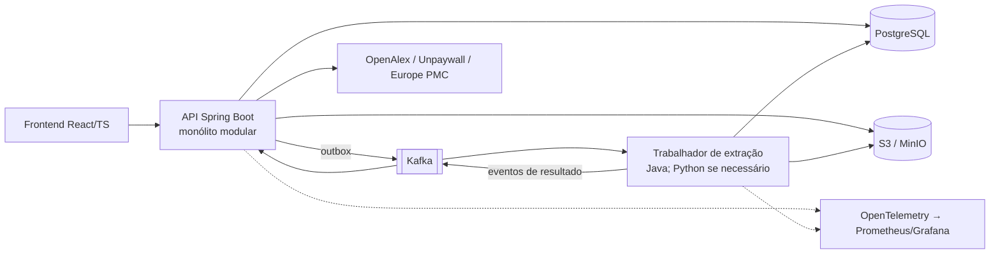
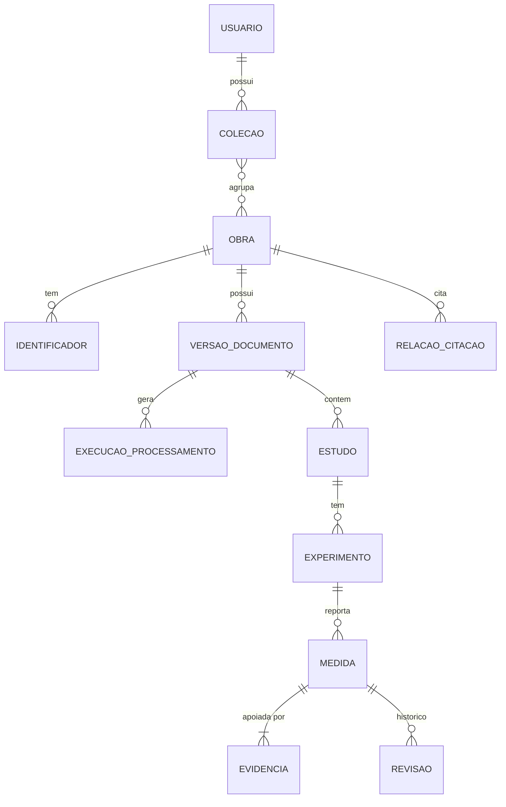

# Atlas Científico — especificação inicial

Projeto pessoal de portfólio, sem vínculo com empregador. Independente de qualquer outro repositório do autor.

**Legenda de estado.** O roteiro em `docs/roteiro.md` é a fonte de verdade para o estado de implementação e testes de cada entrega. Esta especificação registra o desenho e as hipóteses; itens ainda não verificados continuam planejados.

## 1. Produto e diferencial

O Atlas Científico permite pesquisar um tema, explorar a rede de citações, comparar estudos em uma matriz estruturada e conferir de onde veio cada informação extraída.

**Diferencial:** ligar *artigo → experimento → resultado → trecho de evidência*. Cada valor na matriz de comparação aponta para o trecho e a página de origem, preserva o valor e a unidade originais, e carrega um estado (reportado, inferido, ausente, pendente de revisão).

**Limites declarados**
- Não identifica a verdade científica nem comprova causalidade.
- Resultados diferentes não são chamados de contradição. O sistema só alinha valores numericamente quando unidades e condições permitem uma comparação justificável; caso contrário mostra os dois lado a lado, sem veredito.
- Contagem de citações é indicador bibliométrico, não de qualidade.
- Sem texto completo disponível, o trabalho fica como registro de metadados.

## 2. Recorte científico inicial (hipótese)

Comparação qualitativa. **Não medi** disponibilidade de literatura aberta; isso é a primeira validação da entrega 1.

| Critério | Materiais para baterias | Energia solar | Tratamento de água |
|---|---|---|---|
| Literatura aberta | Boa (preprints, periódicos de acesso aberto) | Boa | Boa, mas dispersa por subáreas |
| Métricas numéricas definidas | Sim: capacidade, eficiência coulômbica, retenção em ciclos | Sim: eficiência de conversão, Voc, Jsc, FF | Variável por contaminante e processo |
| Dependência de condições | Alta e explícita (taxa C, janela de tensão, eletrólito, temperatura) | Média (iluminação, área, certificação) | Alta, pouco padronizada |
| Dificuldade de extração | Alta: valores em tabelas e figuras | Média: tabelas de desempenho mais padronizadas | Alta: heterogeneidade |
| Valor para a demonstração | Alto: comparação só faz sentido com condições alinhadas | Médio | Médio |

**Recomendação (hipótese inicial): materiais de cátodo para baterias de íon-lítio.** A comparação depende de condições experimentais, e é exatamente isso que o diferencial do produto precisa mostrar. O custo é a extração mais difícil. Energia solar (células de perovskita) é a alternativa se a extração de baterias se mostrar inviável no conjunto de referência. A arquitetura mantém o domínio em um módulo separado para permitir trocar ou acrescentar áreas.

## 3. Fontes e obtenção de documentos

Estado da verificação, com data de consulta 2026-10-22:

| Fonte | Verificado em fonte primária? | O que se sabe |
|---|---|---|
| OpenAlex | Sim ([página de autenticação e limites](https://help.openalex.org/how-to-use-the-api/rate-limits-and-authentication), atualizada em 2026-10-15) | Funciona sem chave com limite menor; chave gratuita aumenta o orçamento diário e é exigida para cursor paging; 10 req/s sem chave, 30 com chave; 429 ao exceder |
| Unpaywall | **Parcial** — a página de documentação exige JavaScript e não pôde ser lida; o endpoint real foi chamado em 2026-10-23 | Confirmado por chamada: `GET https://api.unpaywall.org/v2/{doi}?email=...` responde 200 em JSON, com `best_oa_location` (`url_for_pdf`, `version`, `host_type`, `license`). Em um DOI testado `license` veio nulo e `evidence` veio `deprecated`, então licença não pode ser presumida. **Não confirmado:** limite de requisições e termos de uso |
| Europe PMC | **Parcial** — a documentação da API retornou 403; o endpoint real e a página de acesso aberto foram lidos em 2026-10-23 | Confirmado por chamada: `GET https://www.ebi.ac.uk/europepmc/webservices/rest/search?query=DOI:...&format=json` responde 200, com `pmcid`, `isOpenAccess`, `inPMC`, `hasPDF`, `citedByCount`. A [página de acesso aberto](https://europepmc.org/downloads/openaccess) diz que as licenças variam e que vale a declaração de cada artigo. **Não confirmado:** limites de requisições; `isOpenAccess` veio `N` para um artigo que está no PMC, então esse campo não basta para decidir permissão |
| Sci-Hub | Parcial, por fontes secundárias | Decisões judiciais por violação de direitos autorais (EUA, 2017, à revelia; Índia, 2025) e nenhuma API oficial encontrada |

**Decisão sobre o Sci-Hub:** **não integrar.** Não há API documentada nem base de permissão que eu tenha verificado, e há decisões judiciais contra o serviço. O funcionamento principal nunca depende dele, e o projeto não implementa mecanismos de contorno de acesso. Reavaliar apenas se surgir base legal documentada.

Cada conector é independente, atrás da mesma interface (`SourceConnector`): descoberta, metadados, localização de versão aberta. O sistema distingue três níveis para cada trabalho: **metadados disponíveis**, **texto completo acessível** e **permissão para armazenar ou redistribuir**. Para cada documento registra-se origem, identificadores, versão, data de coleta, licença (quando conhecida) e hash SHA-256.

PDFs enviados pelo usuário entram com uma declaração explícita de que ele tem autorização para processá-los.

## 4. Arquitetura

Princípio: **monólito modular em Java com um trabalhador de extração separado**, não microsserviços. Dois artefatos implantáveis na primeira versão.

Módulos dentro da API: `catalogo` (obras, deduplicação, coleções), `fontes` (conectores), `documentos` (upload, estados), `extracao` (resultados, revisão), `dominio.baterias` (campos e comparação), `acesso` (autenticação, autorização), `operacao` (acompanhamento).

| Componente | Problema que resolve | Alternativa mais simples | Por que escolhido | Custo operacional |
|---|---|---|---|---|
| PostgreSQL | Dados relacionais, constraints, histórico | — | Núcleo do modelo; busca textual básica incluída | Baixo |
| Kafka | Processamento assíncrono com reprocessamento e retentativas | Fila no próprio Postgres | **Hipótese a validar:** o ganho é demonstrar eventos e reprocessamento. Se a entrega 3 mostrar que a fila no Postgres basta, troca-se e registra-se a decisão | Médio |
| S3 / MinIO | Documentos originais e artefatos derivados | Disco local | Exclusão e versão por objeto; mesmo contrato na AWS | Baixo |
| Trabalhador separado | Extração pesada isolada da API; bibliotecas documentais | Mesma JVM | Falha e escala independentes; permite Python só se uma biblioteca justificar | Médio |
| OpenSearch | Busca por relevância | Busca textual do Postgres | **Adiado.** Entra só se a busca do Postgres falhar em um critério medido | Alto |
| React/TS | Grafo e matriz navegáveis | Telas renderizadas no servidor | O grafo exige interação no navegador | Médio |
| AWS (ECS/Fargate, RDS, S3, MSK ou alternativa) | Implantação demonstrável | Docker Compose local | Competência visada; custo a estimar antes da entrega 6 | Alto |

Kubernetes: não usado.

## 5. Modelo inicial de dados

Pontos de projeto:
- `IDENTIFICADOR`: DOI, OpenAlex ID, PMID etc.; restrição de unicidade por (tipo, valor).
- `RELACAO_CITACAO.origem`: `FONTE` ou `INFERIDA`, com a fonte.
- `VERSAO_DOCUMENTO`: origem, versão (preprint, aceito, publicado), data de coleta, licença, SHA-256, chave do objeto no S3, direito de armazenamento.
- `EXECUCAO_PROCESSAMENTO`: versão do processador, modelo, prompt e esquema; estado (`PENDENTE`, `EM_ANDAMENTO`, `PARCIAL`, `FALHOU`, `PRECISA_OCR`, `PRECISA_REVISAO`, `CONCLUIDO`); chave de idempotência (hash do documento + versão do processador).
- `MEDIDA`: `valor_original` (texto), `unidade_original`, `valor_normalizado` e `unidade_normalizada` anuláveis, `incerteza`, `estado` (`REPORTADO`, `INFERIDO`, `AUSENTE`, `PENDENTE_REVISAO`). O valor original nunca é sobrescrito.
- `EVIDENCIA`: página, trecho e posição em pontos de código Unicode (início inclusivo, fim exclusivo); obrigatória para estado diferente de `AUSENTE`. Evidências antigas podem ter posições nulas.
- `REVISAO`: autor, valor anterior, valor novo, motivo, data. Correções acrescentam linhas; não alteram o histórico.
- Campos do domínio de baterias (cátodo): material, taxa C, janela de tensão, eletrólito, temperatura, massa ativa, capacidade específica, retenção após N ciclos, eficiência coulômbica.

## 6. Fluxo de eventos

1. `DocumentoImportado` (gravado na mesma transação que o registro, via outbox).
2. Trabalhador consome, valida arquivo, extrai texto por página → `TextoExtraido` ou `DocumentoPrecisaOcr`.
3. Extração estruturada com evidência → `ExtracaoConcluida`, `ExtracaoParcial` ou `ExtracaoFalhou`.
4. API consome resultados, persiste e muda o estado.

**Garantias reais.** Entrega *pelo menos uma vez* com consumidores idempotentes: a chave (hash do documento + versão do processador) impede resultados duplicados no reprocessamento. Não se promete "exatamente uma vez". Retentativas limitadas com recuo exponencial; esgotadas, a mensagem vai para a fila de falhas com a causa. Se um trabalhador morre durante o processamento, a mensagem não confirmada é reentregue; o estado `EM_ANDAMENTO` tem prazo e volta a `PENDENTE`.

## 7. Segurança e confiabilidade (compromissos de projeto)

Validação de tipo, tamanho e estrutura do PDF; importação por URL só de destinos permitidos, sem acesso a redes internas (proteção contra SSRF); conteúdo dos artigos tratado como dados não confiáveis nos prompts; propriedade de coleções verificada em cada consulta; segredos em AWS Secrets Manager e nunca em logs; exclusão de um documento remove o objeto original, os derivados e as extrações; logs sem trechos de conteúdo privado; limites de concorrência e respeito aos limites das APIs externas (inclusive tratamento de 429).

## 8. Avaliação

Conjunto de referência pequeno, revisado manualmente, com PDFs de duas colunas, tabelas, texto escaneado e extração incompleta. Métricas medidas separadamente: correção dos campos, correspondência afirmação–evidência, tratamento de informação ausente, preservação de valor e unidade, erros de associação entre experimentos, tempo e custo por documento. Nota dada por outro modelo não é prova de qualidade. Números só são publicados depois de medidos, com hardware, conjunto de dados e configuração.

Engenharia: testes de deduplicação, mensagens repetidas, falha de provedor, interrupção do trabalhador, isolamento de acesso, reprocessamento por mudança de versão e carga.

## 9. Entregas

Cada entrega termina executável. O roteiro em `docs/roteiro.md` mantém o estado atual de implementação e os critérios de conclusão; esta seção descreve o escopo-alvo.

**1. Importar, processar e mostrar evidência (vertical mínima)**
- Objetivo: importar um artigo de acesso aberto permitido (ou PDF do usuário), processar, persistir e exibir medidas com evidência.
- Escopo: API Spring Boot, PostgreSQL, armazenamento local compatível com S3, um trabalhador, extração de texto por página, extração de poucos campos com resposta de IA pré-gravada para a demonstração, tela mínima de evidência.
- Dependências: JDK 21 e Docker (disponíveis; ver `docs/ambiente.md`), além da validação do conjunto candidato de artigos.
- Aceite: um documento importado gera uma execução, medidas com página e trecho, e reimportar o mesmo arquivo não duplica nada.
- Testes: JUnit + Testcontainers para idempotência e persistência.
- Demonstração: importar e abrir a evidência de um valor.
- Limitação conhecida: um único domínio, poucos campos, sem OCR.

**2. Descoberta e catálogo.** Conector OpenAlex, busca por tema/DOI/autor, filtros, deduplicação documentada, coleções. Aceite: a mesma obra vinda de duas fontes vira um registro; testes de deduplicação.

**3. Processamento assíncrono robusto.** Kafka (ou fila no Postgres, conforme a decisão da seção 4), outbox, retentativas, fila de falhas, recuperação após interrupção. Aceite: matar o trabalhador no meio não perde nem duplica resultado.

**4. Comparação e revisão humana.** Matriz de comparação, normalização de unidades com valor original preservado, regras de comparabilidade, correção com histórico.

**5. Rede de citações.** Expansão progressiva, relações da fonte versus inferidas, linha do tempo.

**6. Operação e AWS.** OpenTelemetry, métricas, painel de acompanhamento, CI/CD no GitHub Actions, implantação na AWS (estimativa de custo antes).

**7. Avaliação e medição.** Conjunto de referência, relatório de métricas, testes de carga, publicação dos números com método.

## 10. Competências demonstradas

| Parte | Competência para backend Java/AWS |
|---|---|
| Idempotência, outbox, reentrega | Arquitetura orientada a eventos e consistência |
| Modelo com constraints e histórico | SQL e modelagem |
| Testcontainers e testes de falha | Testes automatizados realistas |
| Pipeline e implantação | CI/CD, AWS |
| Métricas e traços | Observabilidade |
| Controle de acesso e validação de entrada | Segurança de aplicação |

## 11. Pendências desta especificação

- Confirmar limites de requisições e termos de uso do Unpaywall e do Europe PMC (a documentação não carregou; só o comportamento dos endpoints foi verificado).
- Medir de fato a disponibilidade de artigos abertos no recorte antes da entrega 1.
- Decidir Kafka versus fila no Postgres após a entrega 3.
- Escolher e revisar o conjunto de referência antes de avaliar extração automática.
- O trecho sobre dois módulos científicos (herpetologia e petrologia) foi tratado como segunda mensagem e **não está incluído** nesta versão.
